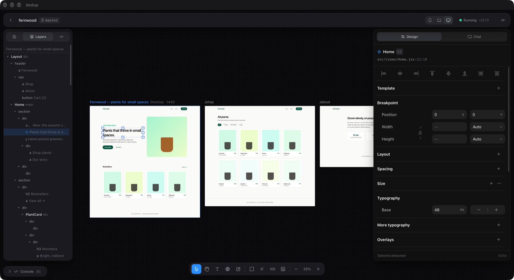
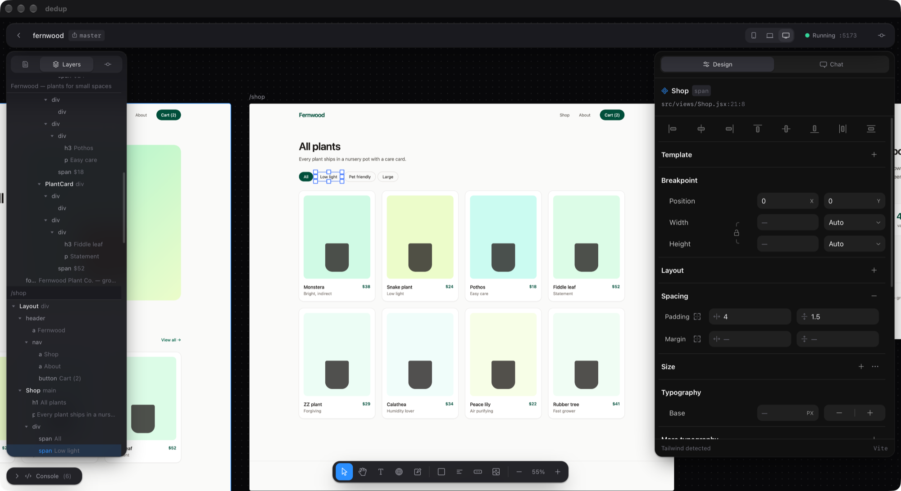
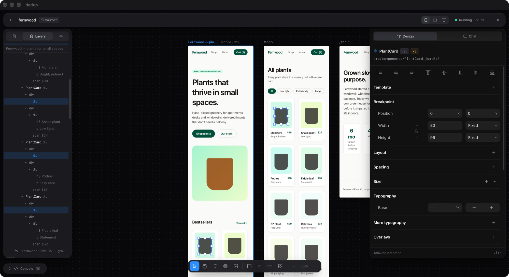

<h1 align="center">dedup</h1>

<p align="center">
  <b>Edit your real React + Tailwind app like a Figma file, and get real code back.</b><br>
  A macOS app. Your code never leaves your machine.
</p>

<p align="center">
  <a href="https://github.com/sadafsajju/dedup/releases/download/v0.1.0/dedup_0.1.0_universal.dmg"><b>⬇ Download for macOS</b></a>
  &nbsp;·&nbsp; <a href="#install">Install guide</a>
  &nbsp;·&nbsp; <a href="#quick-start">Quick start</a>
  &nbsp;·&nbsp; <a href="./LICENSE">MIT license</a>
</p>



dedup opens a project folder, starts its dev server and puts every page on one
canvas. Click any element to restyle it, retype its text, move it, copy it or
delete it. Every change is written into your source files as a small, readable
diff, committed on its own git branch, and only after the edited file has been
re-parsed and checked. There is no account and no cloud service, and the AI
features run on the coding-agent CLIs you already pay for.

> **Status:** early preview (v0.1). macOS only.

---

## What it does

### Click anything, see where it comes from, change it

Select an element and dedup shows the component and the exact source line that
rendered it (`src/views/Shop.jsx:21:8`), plus the layer tree and a design panel
for layout, spacing, size, typography and colour. Changing a value edits the
Tailwind classes in your file, not an inline style.



### Every page, every screen size, at once

Each route is a live artboard of your running app. Switch them all to phone,
tablet or desktop width with **⌘1 / ⌘2 / ⌘3**, and drag them around like Figma
frames. Select a component and every copy of it on the page lights up.



### And also

- **Edit text in place.** Double-click any text and type.
- **Move things.** Drag an element to re-parent it, or into another page. Drop
  it on the empty canvas to park it for later. Copy, cut, paste and delete work
  on one element or a marquee selection.
- **Insert** frames, text, buttons and images from the toolbar.
- **Ask an AI.** Describe the change in the Chat tab. The proposal is applied to
  your files *uncommitted*, so you see it on the canvas before you keep or
  discard it.
- **Mark it up.** Draw boxes, circles, arrows and freehand notes over a page.
  Marks are never written to your code.
- **Preview hard-to-reach states:** signed in vs. signed out, offline, or frozen
  on a splash screen.
- **Export** an artboard as a PNG or vector PDF at its real size.
- **Review and ship** from the Commit tab: see every change, undo one, push the
  session branch, or fast-forward your own branch onto it.
- **Terminals** in the console drawer, already in your project folder.

### Works with

| Project | Preview | Click-to-edit + design panel | AI chat edits |
|---|:-:|:-:|:-:|
| **Vite + React + Tailwind** | ✅ | ✅ | ✅ |
| **Next.js + Tailwind** | ✅ | ✅ ¹ | ✅ |
| **Plain HTML/CSS sites** | ✅ | ✅ | ✅ |
| Astro, Remix, Nuxt, SvelteKit, Vue, Angular, CRA, Gatsby… | ✅ | — | JS/TS/CSS/HTML files |
| Django, Rails, Laravel, Flask, FastAPI, Hugo, Jekyll… | ✅ | — | JS/TS/CSS/HTML files |
| Expo / React Native (web), Flutter web | ✅ | — | Expo only |
| An empty folder | Starts you on a React or HTML starter | ✅ | ✅ |

¹ Next.js needs one line in `next.config`. dedup shows you the diff, commits it
on its own branch, and the line does nothing outside dedup.

---

## Install

### 1. Download

Get **[`dedup_0.1.0_universal.dmg`](https://github.com/sadafsajju/dedup/releases/download/v0.1.0/dedup_0.1.0_universal.dmg)**
(8 MB) from the [Releases page](https://github.com/sadafsajju/dedup/releases).
One download runs natively on both Apple silicon and Intel Macs.

### 2. Move it to Applications

Open the `.dmg` and drag **dedup** into your **Applications** folder.

### 3. Allow it to open, the first time only

dedup isn't notarized by Apple yet, so macOS blocks the first launch and says
it can't verify the app. To let it through:

1. Try to open dedup once, and click **Done** on the warning.
2. Open **System Settings → Privacy & Security**.
3. Scroll down to the message about dedup and click **Open Anyway**, then
   confirm with your password or Touch ID.

Or, from Terminal:

```bash
xattr -dr com.apple.quarantine /Applications/dedup.app
```

After that it opens like any other app.

### 4. Make sure you have the tools your project uses

dedup runs *your* project's dev server, so it needs what you'd need to run it
yourself:

- **Node.js**: the version your project needs (current Vite wants 20.19 or
  newer). dedup finds it through your shell, including nvm, fnm and asdf.
- **git** (recommended): every save is a commit you can undo. Without git,
  dedup warns you before it overwrites a file.
- **For AI chat (optional):** one of the `claude` CLI, the `codex` CLI, or an
  Anthropic API key. See [AI chat](#ai-chat).

### Build from source instead

You'll need Xcode Command Line Tools (`xcode-select --install`), Node 20+,
pnpm and [Rust](https://rustup.rs).

```bash
git clone https://github.com/sadafsajju/dedup.git
```

```bash
cd dedup && pnpm install
```

```bash
pnpm tauri build
```

The app lands in `src-tauri/target/release/bundle/macos/dedup.app`. A build
you make yourself isn't quarantined, so step 3 doesn't apply.

---

## Quick start

1. **Open a project.** Click **Open project…** and pick a folder, or drag one
   onto the window. An empty folder offers a React or HTML starter.
2. **Let it start.** dedup finds your `dev` script (or the right command for
   your stack) and starts the server. Its output is in the **Console** drawer.
   If it can't tell how to start your project, it asks once and remembers.
3. **Open pages.** The **Pages** tab lists your routes. Click one to put it on
   the canvas.
4. **Select and edit.** Click an element and change it in the **Design** panel,
   or double-click text to retype it. Edits show instantly but stay *staged*
   until you save.
5. **Save** with **⌘S**. dedup writes the files and commits them to a
   `dedup/session-…` branch, never to the branch you were on.
6. **Ship it.** The **Commit** tab lists what changed. Undo any save, push the
   session branch, or fast-forward your own branch onto it.

### Shortcuts

| Key | Does |
|---|---|
| **V** | Select: click to inspect, drag to marquee-select, drag a selected element to move it |
| **T** | Text: click text to type into it (double-click works with any tool) |
| **H** or hold **Space** | Hand: pan the canvas |
| **B** | Browse: clicks go to your app, so you can log in or navigate |
| **A** | Annotate: draw on top of the page |
| **⌘1 / ⌘2 / ⌘3** | Phone / tablet / desktop width |
| **⌘C / ⌘X / ⌘V** | Copy / cut / paste the selection |
| **⌫** | Delete the selection |
| **⌘Z / ⇧⌘Z** | Undo / redo staged edits |
| **⌘S** | Save |
| **Esc** | Deselect |
| **⌘,** | Settings |

### Pages behind a login

Press **B** (Browse) and sign in on the canvas the way you normally would. All
artboards share that session, and any artboard can be pinned to *signed out*.
For apps that keep their session in browser storage, dedup can seed a mock
session instead. It tells you up front if your auth provider rules that out.

---

## AI chat

Open **Settings (⌘,)** and connect at least one backend:

| Backend | What you need |
|---|---|
| **Claude Code** | The [`claude` CLI](https://docs.anthropic.com/en/docs/claude-code), installed and signed in (uses your subscription) |
| **Codex** | The [`codex` CLI](https://github.com/openai/codex), installed and signed in. Codex can also generate images for your page |
| **Anthropic API key** | A key from [console.anthropic.com](https://console.anthropic.com), billed per token |

**Connect** does a real round-trip, so a CLI that's installed but signed out
shows up as signed out. With both agents on, start a message with `@claude` or
`@codex` to choose who answers.

Select an element to give the AI context, or don't: the chat works with nothing
selected, which helps when a build error has left the canvas blank.

**The AI never touches your files directly.** It runs with no tools and no write
access. It asks dedup to read files, and replies with exact search/replace edits
that go through the same checks as your own. A proposal shows live and
uncommitted: **Keep** commits it, **Discard** puts every file back
byte-for-byte.

---

## How dedup keeps your code safe

- **Edits go to a session branch.** Each save is a commit on
  `dedup/session-…` containing only the files dedup changed. Your own
  uncommitted or staged work is left alone.
- **Nothing is written unless it still parses.** Each edited file is re-parsed
  (JSX/TSX, CSS, and a structural check for HTML) before it touches disk, and a
  multi-file change applies completely or not at all.
- **Nothing is added to your repo.** dedup's tooling lives in
  `node_modules/.dedup/` (or the app's cache for non-Node projects) and only
  runs inside the dev server dedup starts. Your own `npm run dev`, CI and
  production builds are unaffected.
- **Pushing is explicit.** Push and land happen only when you confirm them by
  branch name. Push never forces. Land is fast-forward only and refuses rather
  than merge.
- **No git? You're told first.** dedup offers to set git up, or names the files
  it will overwrite before it does.

## Known limitations

- macOS only. The canvas and export use WebKit APIs.
- Click-to-edit needs Vite + React, Next.js (webpack), or plain HTML. Other
  stacks get preview and chat.
- Next.js under Turbopack isn't tagged, so dedup runs `next dev --webpack` for
  you. Headers set in a Next `middleware.ts` can still block the canvas.
- Exports don't include staged (unsaved) edits. Save first.
- Native iOS and Android screens can't be shown, only web builds.

---

## Contributing

Issues and pull requests are welcome. Before a non-trivial change:

- Read **[CLAUDE.md](./CLAUDE.md)**, the architecture map and the list of
  hard-won gotchas.
- **[PROGRESS.md](./PROGRESS.md)** records why things are the way they are.
  Please don't reopen a settled decision without a new reason.
- The safety rules above are non-negotiable. A change that writes to user files
  needs a test proving it refuses the bad case.

```bash
pnpm tauri dev         # run the app with hot reload
pnpm build             # typecheck + build the frontend
pnpm build:plugin      # rebuild plugin-src/ bundles (required after editing plugin-src/)
pnpm test:plugin       # write-back + tagger smoke tests (run after build:plugin)
cd src-tauri && cargo test
```

Each area has its own suite (`pnpm test:overlay`, `test:html`, `test:chat`, …).
The full list is in `package.json`.

**Layout:** `src/` is the editor UI (React 19, Tailwind v4, zustand),
`src-tauri/src/` is the Rust core (dev server, git, proxy, export), and
`plugin-src/` is the code that runs *inside* your project's dev server
(element tagging, the in-page overlay, AST write-back).

## License

[MIT](./LICENSE) © 2026 Sadaf Kasim (GetBega Tech)
